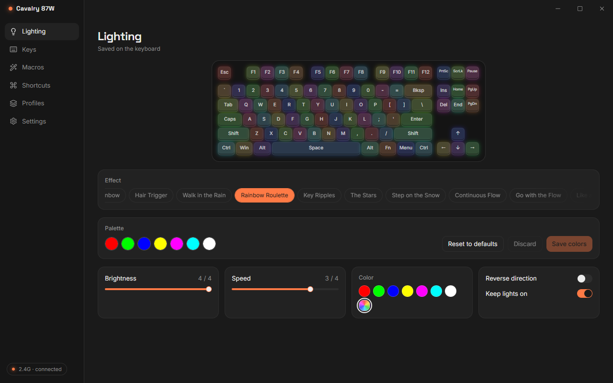
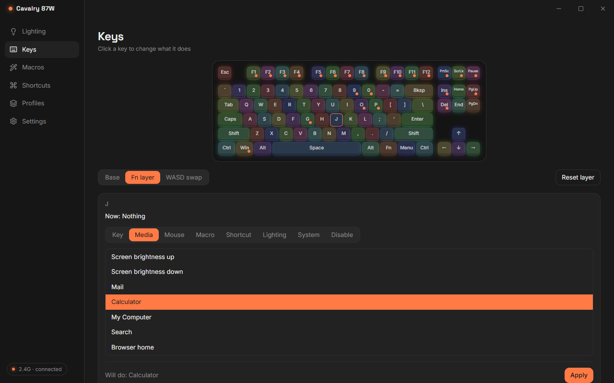
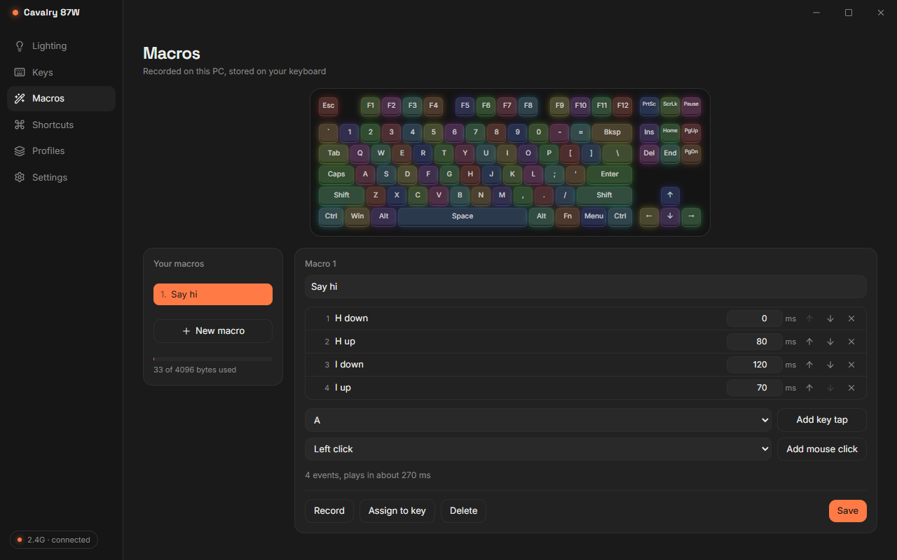
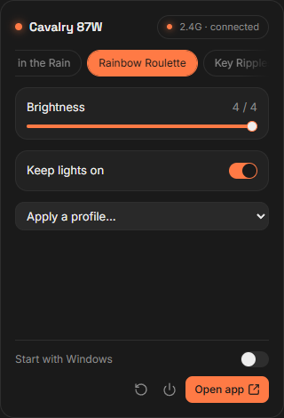

<h1 align="center">Cavalry 87W</h1>

<p align="center">
  Custom software built for the <b>Durgod Cavalry 87W</b> keyboard.<br>
  The software provided by Durgod is dogshit.
</p>

<p align="center">
  <a href="https://github.com/Tanjim-Islam/durgod-cavalry-87w-software/releases/latest"></a>
  
  
</p>

<p align="center">
  
</p>

Every lighting mode, key remap, macro and setting the keyboard has, from one small tray app. It talks to the keyboard directly over the cable or the 2.4G dongle, with no Durgod software installed. The protocol was reverse engineered from the hardware and is documented in [PROTOCOL.md](PROTOCOL.md).

## Features

**Lighting**
- All 17 effects, with brightness, speed, color and direction
- Custom colors for each effect's palette
- Game Mode per-key colors, painted straight onto the keyboard picture
- **Keep lights on**, so the backlight never goes to sleep
- A live preview of the keyboard on every page

**Keys**
- Remap any key on the base layer, the Fn layer and the WASD-swap layer
- Assign keys, key combos, media keys, mouse buttons, shortcuts like Lock PC or Show desktop, lighting controls and system functions
- Remapped keys are marked on the keyboard picture, and any key or layer can go back to factory with one click

**Macros**
- Record a macro by typing it on the PC, then edit every step and delay
- Play it once, a set number of times, while the key is held, or as a toggle
- A storage meter shows how much of the keyboard's macro memory is left

**Everything else**
- A Shortcuts page with every Fn shortcut the keyboard has, including the ones the manual leaves out
- Win/Mac mode, sleep timer and debounce
- Profiles you can save, rename, import and export
- Automatic backups before every change, plus a factory snapshot you can always go back to
- Tray icon: left-click opens the app, right-click opens a quick flyout
- Checks for updates when it opens and installs them in one click (Settings has a Check for updates button too)
- Start with Windows, dark and light themes

<table>
  <tr>
    <td width="50%"></td>
    <td width="50%"></td>
  </tr>
  <tr>
    <td align="center">Remap any key, on any layer</td>
    <td align="center">Record, edit and assign macros</td>
  </tr>
</table>

<p align="center">
  <br>
  <sub>The tray flyout: right-click the tray icon</sub>
</p>

## Download

Grab the latest build from [Releases](https://github.com/Tanjim-Islam/durgod-cavalry-87w-software/releases/latest):

| File | What it is |
|---|---|
| `Cavalry87-Setup-vX.Y.Z.exe` | The installer. Adds a Start menu shortcut, can start with Windows, updates in place, and uninstalls cleanly. No admin rights needed |
| `Cavalry87-vX.Y.Z-portable.exe` | One file, nothing to install, just run it |

Uninstalling keeps your profiles and backups in `%APPDATA%\Cavalry87`.

If you used Durgod's own software before, uninstall it first. Two apps talking to the keyboard at once will fight over it.

## First run

Over 2.4G, lighting and settings work right away.

The keyboard only lets the PC read its keys, macros and colors over the cable. So, once:

1. Plug in the cable.
2. Press **Fn + PrtSc** to switch the keyboard to wired mode.
3. Open the app. It reads everything, saves a factory snapshot, and keeps a local copy.

After that you can switch back to 2.4G with **Fn + ScrLk**, and everything works there too. The app saves a backup before every change it makes, and restoring one is a single click on the Profiles page.

> [!NOTE]
> Keys above F21 (F22, F23, F24) only send over 2.4G. The keyboard's cable mode doesn't support them. The app warns you when you assign one.

## Where things are stored

Everything lives in `%APPDATA%\Cavalry87`:

| Folder or file | Contents |
|---|---|
| `backups\` | The factory snapshot and the last 20 automatic backups |
| `profiles\` | Your saved profiles |
| `mirror.json` | The local copy of the keyboard, used over 2.4G |
| `logs\app.log` | Warnings and errors |

## Build from source

You need Windows 11, Python 3.12 or newer, [uv](https://docs.astral.sh/uv/), Node.js and [pnpm](https://pnpm.io).

```bash
uv venv
uv pip install -e ".[dev]"
pnpm -C ui install
```

Run it:

```bash
pnpm -C ui build
.venv/Scripts/python -m engine
```

For UI work, run `pnpm -C ui dev` in one terminal and `.venv/Scripts/python -m engine --dev` in another. Add `--tray` to start hidden in the tray.

Tests:

```bash
.venv/Scripts/python -m pytest
pnpm -C ui test
```

The test suites never touch the keyboard. `pytest -m hardware -s` runs a read-only check against the real keyboard over the cable.

Build the installer and the portable exe into `dist/` (the installer needs [Inno Setup 6](https://jrsoftware.org/isinfo.php)):

```bash
.venv/Scripts/python scripts/build.py
```

## How it works

- **`engine/`** is the Python side: the keyboard protocol for both links, encoders and decoders for every block (config, key layers, macros, colors, palettes), backups and profiles, and a single device thread that does every read and write.
- **`engine/shell/`** is the desktop app: a [pywebview](https://pywebview.flowrl.com) window, the tray icon, the flyout, start with Windows, and the macro recorder.
- **`ui/`** is the interface: React, TypeScript, Tailwind and Motion. In a normal browser it runs against a built-in mock keyboard, so the UI can be worked on without the hardware.

Every write reads the keyboard first, changes only what was asked, writes it, then reads it back to check. If the link drops in the middle, the change is applied again once the keyboard reconnects.

## Not supported

- **Battery level.** The keyboard doesn't report it over either link. Durgod's own software can't show it either.
- **Bluetooth.** The app works over the cable and the 2.4G dongle. Bluetooth pairing and switching still work from the keyboard's own Fn shortcuts.
- **Factory reset and clearing Bluetooth pairings** are left to the keyboard's own Fn shortcuts on purpose, so a misclick in the app can't wipe the board.
